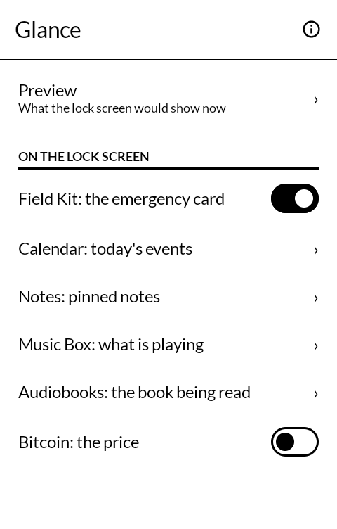
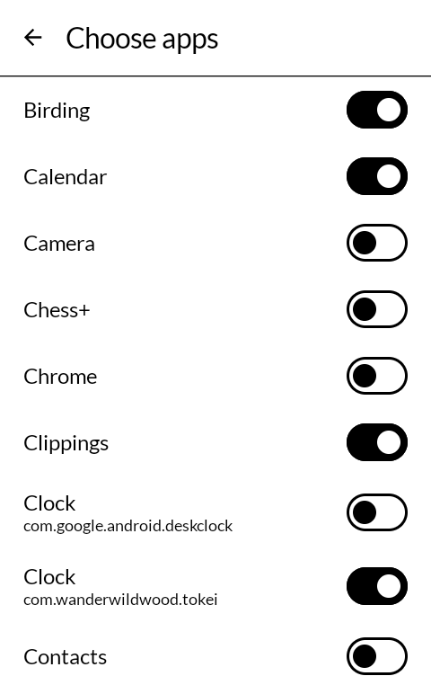

# 一目 hitome — Glance

Today's events, the weather and what is unread, on the lock screen of a Mudita Kompakt, so the
day can be seen without unlocking the phone.

This is a fork of [wander wildwood's Glance](https://github.com/wanderwildwood/hitome). It keeps
that app's package name, so Calendar, Sky and the others still hand it their lines. Added here:
a utilities row (moon, hotspot, camera), and a place for any other app that hands over lines.
Choosing a size for the time and date is in the code and not offered yet: look at that again
before a release, because the cover sat on the music controls.

*Hitome* is 一目 — one look, a glance.

| | |
|---|---|
|  |  |
|  |  |

## What it shows

A panel under the clock and date, in the lock screen's own dotted rules, in this order until you
change it:

- **The emergency card**, from Field Kit, once its "Show on the lock screen" is on: the
  fields left ticked on the card, allergies and conditions in bold.
- **Today**, from [Calendar](https://github.com/wanderwildwood/koyomi): all-day events first,
  then what is still to come, with times. When there is not room for them all, it shows the
  first and how many more. Once today's are over, Calendar can name the next event, with its
  day, if that is switched on in its settings. Without Calendar, turn on **Today's events** in Glance and it reads
  today itself: from Mudita's own Calendar, and from the phone's other calendars if you allow
  calendar access.
- **The next dose**, from [Medicine](https://github.com/wanderwildwood/fukuyaku), once
  "Next dose on the lock screen" is on in its settings: a dose that rang and is not marked yet,
  in bold, then the next one due.
- **The weather**, from [Sky](https://github.com/wanderwildwood/soramoyo): the temperature
  now, the day's high and low, and a line when rain or snow is likely soon.
- **Almanac** (`com.heavencanthandle.almanac`): the lines that app hands over, once it is
  installed and its own lock-screen switch is on. The same switch is what lets the moon
  icon draw; those lines stay in the panel.
- **Pinned notes**, from [Notes](https://github.com/wanderwildwood/oboegaki): each by its title,
  and a list with how much of it is left, "Groceries · 3 to do".
- **Today's tickets**, from [Wallet](https://github.com/wanderwildwood/satsuire): the names of
  the cards good for today, a boarding pass on the day of the flight. Never the barcode.
- **What is playing**, from [Music Box](https://github.com/wanderwildwood/jimeikin) and
  [Audio Reading](https://github.com/wanderwildwood/mimidoku): the song and who sings it, or the
  book and its chapter (or the time left in a book with no chapters), and whether it is paused.
  Nothing once playback stops, and nothing while that app's own lock-screen controls are on,
  since they already say it.
- **The bitcoin price**, from [Bitcoin](https://github.com/wanderwildwood/zeni), off until
  switched on in both Bitcoin's App Settings and Glance: the price and how it moved in a day.
  Never a balance.
- **Unread**, from [Messaging](https://github.com/wanderwildwood/kotozute) and
  [Email](https://github.com/wanderwildwood/tayori): "2 messages · 1 email", and nothing when
  nothing is unread.
- **Other apps**, if you want them: the name of each app you choose and how many notifications
  it has waiting - "Signal 2 · Clock 1" - on up to two lines. What they say stays off the lock
  screen unless you turn on **Show what they say**; then each app gets a line with its newest
  notification, "Signal 2  Mom: see you at five", except where Android itself would hide it.
  Messaging and Email then get a line of their words too, under their counts.

Pressing a section, or an app's name, unlocks the phone and opens that app. Pressing a utility
icon does not: the hotspot turns over and the phone stays locked. The camera is the exception: it
unlocks, then opens.

**Utilities.** One row of icons under the clock, or under the music controls when they are
showing. The row has a switch, and so does each icon. **Moon** is Almanac's phase, drawn like
Almanac's: paper is the sunlit side, ink the shadow. **Hotspot** asks the phone to start or stop
the internet hotspot; Android may refuse that. **Camera** unlocks the phone and opens the camera,
the same as pressing an app's lines. The torch is not on the row: it is **Power pressed twice**,
below.

**Time and date.** The phone's own clock stays. A chooser for the size is written and not
shown: look at it again before a release.

Glance knows nothing on its own. Each app hands it its own lines and has its own switch, in its
own settings, to stop. An app that is not installed, has nothing to say, or has its switch off
simply leaves no line. Field Kit, Medicine and Wallet also wait for a switch in Glance, under
**What it shows**, which is there once the app is installed and off until you turn it on. Any
other installed app with a `.glance` provider is listed there the same way, off until it is
switched on. Other apps' notifications are the exception: Glance counts them itself, and only
for the apps you choose.

## Where it sits

It measures where the lock screen's own items end - the date, the charging line, the music
controls - and starts below the lowest, each time the screen wakes. An overlay under the clock,
such as Music Box's controls, is part of that header, so the controls stay whole and the panel
sits under them. A strip drawn at the foot of the screen stays below the panel. The panel also
stops above the padlock.

The parts are drawn in the order they are listed under **What it shows** in Glance, which is
the order above until you change it: hold a row and drag it, or hold and let go for **Move to
top**, **Move up** and **Move down**. Unread and other apps' counts move as one. When there is
not room for all of it, the parts nearest the top are kept, and today's events give up lines
before anything else.

It works with Mudita's own launcher, with inkOS, and with Katapult. When Katapult draws its own
lock-screen widgets, Glance fits around them, above or below, wherever it fits whole. If it fits
nowhere, it does not show; dragging Katapult's notifications lower makes room.

## Turning it on

1. The phone needs a screen lock, even just **Swipe**. With the lock set to None there is no lock
   screen to draw on.
2. Open Glance and press **The panel is off**: it opens Android's Accessibility settings. Turn on
   **Glance on the lock screen**.
   Installed from a file on Android 13 or later, Android may refuse that switch (and notification
   access) at first: open App info, tap ⋮, then **Allow restricted settings**, and try again.
   Glance says so, with an App info button, when the switch came back off.

3. **Preview** shows what the lock screen would show now, so each switch can be tried without
   locking the phone.
   **Text size** draws the panel at Normal, Large or Larger: the words, headings and rules grow
   together, and the panel still stops above the music strip and the padlock.
4. For other apps: press **Notifications are not counted**, turn on notification access for
   Glance, then **Choose apps**. Nothing is counted until you choose at least one.

**Ring for calls only**, under **Other apps' notifications**, lets calls and alarms ring and brings every other
notification in silent; they still show on the lock screen and on the panel. It is a Do Not
Disturb rule of Glance's own, listed with the phone's other Do Not Disturb rules, and it leaves
the phone's own Do Not Disturb settings alone. It needs notification access. Turning on the
phone's own Do Not Disturb and off again also turns this off; press it again to bring it back.

**Power pressed twice**, under **Torch**, turns the torch on or off with two quick presses of the
power key, locked or not. The Kompakt has Android's own double press switched off, and no app can
hear the power key, so Glance watches the screen go on and off instead: two changes within about
half a second are two presses. It is the white light, the camera's torch: Mudita's warm light
answers only Mudita's own apps, and Mudita's control panel does not show this one as on. So while
it is on, the panel says **Torch on** at the top; press it to turn the torch off. It is off until
you turn it on, and works while Glance is on in Accessibility. With fingerprint unlock on, press with a
finger that is not enrolled: the power key reads fingerprints, and an enrolled one unlocks the
phone.

An overlay above the lock screen is a window only an accessibility service is allowed to add,
which is why it needs that switch. Counting notifications needs notification access, which
Android grants to all of them; Glance counts only the ones you chose. See [PRIVACY.md](PRIVACY.md) for what it reads.

## On a Mudita Kompakt

DuraSpeed, a MediaTek service on the Kompakt, closes installed apps a few minutes after the
screen goes dark and keeps them closed until they are opened again. For Glance that means the
counts on the lock screen can stop changing. Mudita's own apps are on its allow list; this one
has to be added, once.

Kompakt's Settings has no way in to DuraSpeed: no menu entry, and no search box to look for it
in. Its own screen will not open for another app either, but its App info page will. Messaging
and Whereabouts each have a button that goes there; without either, from a computer with `adb`:

    adb shell am start -a android.settings.APPLICATION_DETAILS_SETTINGS -d package:com.mediatek.duraspeed

Then, on the phone:

1. Tap **Open** on DuraSpeed's App info page.
2. Switch **Glance** on in the list. **On means allowed** to run in the background, which is
   easy to read the wrong way round. Switching DuraSpeed off at the top works too, for every app.

## Getting it, and keeping it

Build it from this tree and sideload that APK. It installs as `com.wanderwildwood.hitome`, the
same id as upstream, so the other apps keep answering it. The signature is yours, not
upstream's: if upstream's Glance is already installed, uninstall that once before this one.
Point Obtainium at this repository, not at `wanderwildwood/hitome`.

Upstream is the git remote `upstream`. Its history is kept, so a later Glance can be merged.

## Building

```
./gradlew assembleRelease
```

A release is signed by a keystore in `signing/`, which is not in this repository. Without it the
release APK builds **unsigned** and will not install anywhere; there is no fallback key.

## For other apps

Any app can take part: a read-only provider at `<package>.glance/lines` with the columns
`heading`, `lead`, `text` and `bold`, answering only `com.wanderwildwood.hitome`. The file the
apps share is `glance/GlanceProvider.kt` in any of them. Glance lists every installed app that
has one, under **On the lock screen**, off until it is switched on here. The app's own switch
still decides whether the lines exist.

## On the home screen

Glance can hand the panel's lines to inkOS:wndr, to draw on its home screen under the apps: the
same apps, in the order and with the switches chosen here, and for each one whether it shows and
why (on, off in the app, off in Glance, not installed, needs an update, did not answer). Other
apps' notifications are never part of it. It answers only inkOS:wndr, checked by its package name
and the certificate its releases are signed with; any other app that asks gets nothing.

## Credit

The way the panel is drawn above the lock screen, and when it is taken down, follows
[Katapult](https://github.com/gezimos/Katapult) by gezimos, GPL 3.0. Built on
[MMD](https://github.com/mudita/MMD), Mudita's E Ink component library. Icons are
[Material Symbols](https://fonts.google.com/icons), Apache License 2.0.

## Licence

**GNU General Public License, version 3.** See [LICENSE](LICENSE).

Copyright © wander wildwood.
